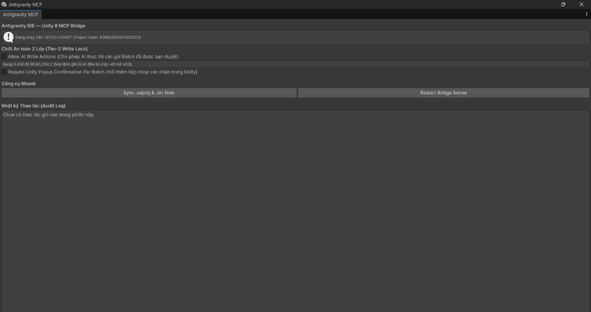
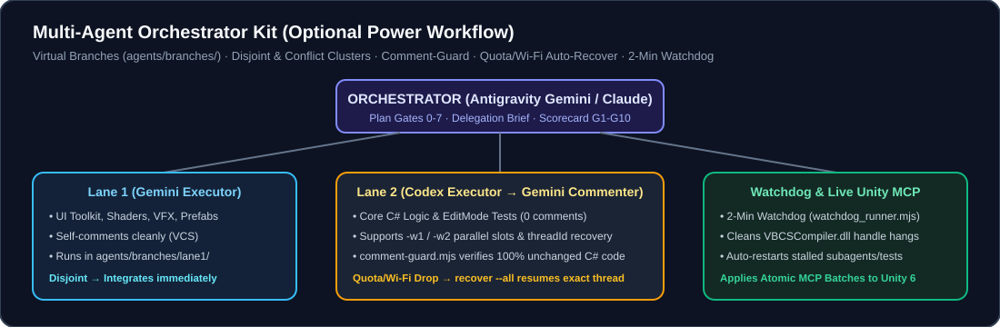
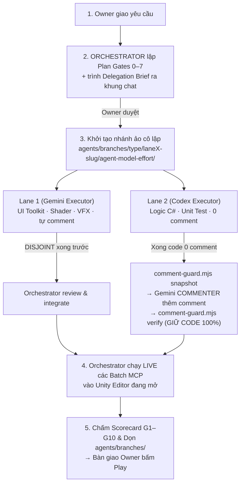

<p align="center">
  
</p>

<h1 align="center">Unity-Antigravity-MCP</h1>

<p align="center">
  <strong>Plugin MCP toàn diện cho Unity 6 &amp; C# trên Antigravity IDE + Gói Unity Package Manager (UPM) + Bộ khung Multi-Agent Orchestrator (All-in-One)</strong>
</p>

<p align="center">
  
  
  
  
</p>

<p align="center">
  
</p>

---

## Mục lục
1. [Tính năng nổi bật](#1-tính-năng-nổi-bật)
2. [Hướng dẫn trực quan & Video Demo](#2-hướng-dẫn-trực-quan--video-demo)
3. [Cài đặt đầy đủ trong 2 phút (Mọi dự án & Mọi máy)](#3-cài-đặt-đầy-đủ-trong-2-phút-mọi-dự-án--mọi-máy)
4. [Cách sử dụng bảng điều khiển trong Unity Editor](#4-cách-sử-dụng-bảng-điều-khiển-trong-unity-editor)
5. [Danh mục 18 công cụ MCP (2 tầng an toàn)](#5-danh-mục-18-công-cụ-mcp-2-tầng-an-toàn)
6. [Vận dụng Bộ Multi-Agent Orchestrator (Gói B — Dành cho máy có đủ Antigravity + Codex)](#6-vận-dụng-bộ-multi-agent-orchestrator-gói-b--dành-cho-máy-có-đủ-antigravity--codex)
7. [Cơ chế an toàn, chống mất Wi-Fi / hết Usage & Watchdog 2 phút](#7-cơ-chế-an-toàn-chống-mất-wi-fi--hết-usage--watchdog-2-phút)
8. [Kiểm thử & Đóng góp](#8-kiểm-thử--đóng-góp)

---

## 1. Tính năng nổi bật

- **Cài đặt 1 chạm từ Unity Package Manager (UPM Git URL):** Chỉ cần dán `https://github.com/QuangVinh-coder/Unity-Antigravity-MCP.git?path=/unity-package` vào Package Manager của bất kỳ dự án Unity 6 nào. **Không cần cài `Newtonsoft.Json` hay bất kỳ DLL ngoài nào** (tích hợp sẵn bộ phân tích JSON DOM đệ quy thuần C# `AntigravityJson`).
- **Tự đăng ký Antigravity IDE làm External Script Editor chính thức của Unity:** Tự động sinh chuẩn file `.sln` và toàn bộ `.csproj` cho mọi `.asmdef`, xử lý tận gốc lỗi báo đỏ `CS0229` trong Antigravity IDE.
- **18 công cụ MCP phủ toàn bộ phân hệ Unity Editor:**
  - **9 công cụ Tầng 1 (Chỉ đọc):** Trạng thái Editor & `EditorBuildSettings.scenes`, Console logs, Scene Hierarchy (tự cảnh báo duplicate root `PRE-3` & `NetworkBehaviour` thiếu `NetworkObject`), kiểm tra sâu `SerializedObject`, tìm Asset/GUID/TypeCache, liệt kê gói UPM, chẩn đoán `.asmdef` vs `.csproj`, đọc `Operation Journal`, chạy `TestRunnerApi` (EditMode/PlayMode).
  - **9 công cụ Tầng 2 (Modular Atomic Batches):** Dựng Scene/Prefab, thiết kế **uGUI & UI Toolkit (`UXML`/`USS`/`UIDocument`)**, chỉnh **Animator Controller**, tạo & tinh chỉnh **ParticleSystem/VFX**, tạo **ScriptableObject/Material**, tương tác **PackageManager**, và **Động cơ Vạn năng `SerializedObject`** hỗ trợ gán trực tiếp `ObjectReference` bằng cú pháp `"hierarchy:Path#Component"`, `"asset:Assets/..."`, `"sprite:Assets/...png#Frame"`, `"guid:..."`, `Enum` theo tên, `Vector2/3`, `Color`, mảng.
- **An toàn 2 lớp & Hoàn tác nguyên tử:**
  - **Lớp 1:** Chặn Fail-Closed mọi lệnh ghi thiếu `ownerApproved: true`, `approvalSummary` và `operationId`.
  - **Lớp 2:** Công tắc **`Allow AI Write Actions`** trong Unity Editor (mặc định **TẮT**, tự động khóa lại sau **15 phút** không thao tác).
  - Mọi Batch gộp vào **1 thao tác `Ctrl + Z` (`Undo`)**, tự rollback sạch 100% nếu có lỗi ở bất kỳ bước nào, và **không bao giờ tự lưu đè Scene**.
- **Tặng kèm Bộ khung Multi-Agent Orchestrator (`templates/multi-agent/`):** Dành cho người dùng có cả Antigravity IDE + Codex CLI — hỗ trợ nhánh ảo `agents/branches/`, phân vai Comment (`comment-guard.mjs`), phục hồi hết usage/rớt mạng (`-w1`/`-w2`), và Watchdog 2 phút chống treo tiến trình nền (`VBCSCompiler.dll`).

---

## 2. Hướng dẫn trực quan & Video Demo

<p align="center">
  
</p>

### Video hướng dẫn Setup & Demo thực tế
> **Mẹo dành cho tác giả / chủ repo:** GitHub hỗ trợ kéo-thả trực tiếp file video `.mp4` / `.mov` vào mục chỉnh sửa `README.md` trên trình duyệt (GitHub sẽ tự động chuyển thành trình phát video gốc có nút Play). Sau khi quay màn hình 1–2 phút minh họa bước **Package Manager → Bật `Allow AI Write Actions` → Chạy thử Batch UI Toolkit / Shader lửa Minecraft**, bạn chỉ cần kéo thả file `.mp4` thay thế khung mẫu dưới đây:

| Kịch bản Demo | Nội dung minh họa | Trạng thái |
|---|---|---|
| **Demo 1 — Setup trong 2 phút** | Cài `install.ps1` → dán Git URL vào Unity Package Manager → bật công tắc trên `Tools > Antigravity MCP > Control Panel` | *Sẵn sàng chèn link/file `.mp4` của bạn* |
| **Demo 2 — Tương tác sống trên Unity 6** | AI dựng Scene 2D, UI Toolkit chọn nhân vật + HUD 2 Skills, Animator, Shader URP 17 lửa lấp lánh Minecraft & bấm `Ctrl + Z` hoàn tác 1 bước | *Sẵn sàng chèn link/file `.mp4` của bạn* |
| **Demo 3 — Multi-Agent Orchestrator** | Orchestrator chia song song Lane 1 (`Gemini`) + Lane 2 (`Codex` 0 comment → `Gemini Commenter` + `comment-guard.mjs`) | *Sẵn sàng chèn link/file `.mp4` của bạn* |

---

## 3. Cài đặt đầy đủ trong 2 phút (Mọi dự án & Mọi máy)

### Yêu cầu hệ thống
- **Unity:** `6000.0` (Unity 6) trở lên.
- **Node.js:** `18.0+` (khuyên dùng `20+` hoặc `22+`). **Không cần chạy `npm install`** (0 dependency ngoài).
- **Git:** Đã cài `git` trên máy để Unity Package Manager tải gói từ GitHub.
- **Antigravity IDE:** Đã cài trên máy.

---

### Bước 1 — Cài Plugin MCP vào Antigravity IDE (chỉ làm 1 lần duy nhất cho cả máy)

#### Trên Windows (PowerShell):
```powershell
irm https://raw.githubusercontent.com/QuangVinh-coder/Unity-Antigravity-MCP/main/install.ps1 | iex
```

#### Trên macOS / Linux (Bash):
```bash
curl -fsSL https://raw.githubusercontent.com/QuangVinh-coder/Unity-Antigravity-MCP/main/install.sh | bash
```

**Script cài đặt tự động làm gì?**
1. Clone kho này vào `~/.gemini/config/plugins/unity-antigravity-mcp/`.
2. Tự sinh file `mcp_config.json` khớp chính xác đường dẫn thư mục người dùng trên máy bạn (không bị cứng tên máy).
3. Chạy ngay bộ tự kiểm thử `node --test server/test-mcp-server.mjs` (xác nhận **6/6 PASS**).
4. Antigravity IDE tự động nạp Plugin, **18 MCP Tools**, `rules/AGENTS.md` và skill `unity-antigravity-mcp`.

---

### Bước 2 — Cài Cầu nối vào bất kỳ dự án Unity 6 nào bằng Package Manager

1. Mở dự án Unity 6 của bạn.
2. Vào menu **`Window` → `Package Manager`**.
3. Bấm dấu **`+`** ở góc trên bên trái → chọn **`Install package from git URL...`**
4. Dán chính xác đường dẫn sau rồi bấm **Install**:
   ```text
   https://github.com/QuangVinh-coder/Unity-Antigravity-MCP.git?path=/unity-package
   ```
   *(Hoặc thêm trực tiếp vào `Packages/manifest.json` của dự án Unity):*
   ```json
   {
     "dependencies": {
       "com.vinh.antigravity-unity-bridge": "https://github.com/QuangVinh-coder/Unity-Antigravity-MCP.git?path=/unity-package"
     }
   }
   ```

### Bước 3 — (Khuyên dùng) Chọn Antigravity IDE làm External Script Editor để xóa lỗi đỏ `CS0229`
1. Trong Unity Editor, vào **`Edit` → `Preferences` → `External Tools`** (macOS: `Unity` → `Settings` → `External Tools`).
2. Ở mục **External Script Editor**, chọn **`Antigravity IDE`**.
3. Bấm **`Regenerate project files`** (hoặc bấm nút **`Sync .csproj & .sln Now`** trong bảng Control Panel bên dưới).

---

## 4. Cách sử dụng bảng điều khiển trong Unity Editor

Sau khi cài xong gói UPM ở Bước 2, vào menu **`Tools` → `Antigravity MCP` → `Control Panel`** trong Unity Editor:

<p align="center">
  
</p>

- **Dòng trạng thái trên cùng:** Khi hiện `Đang chạy trên 127.0.0.1:<PORT> (Project Hash: ...)` nghĩa là Unity Editor đã kết nối sẵn sàng với Antigravity IDE.
- **Chốt An toàn 2 Lớp (`Tier-2 Write Lock`):**
  - ✅ **`Allow AI Write Actions`:** Mặc định **TẮT** (`READ_ONLY`). Tích bật khi bạn muốn cho phép AI thực thi các gói Batch mà bạn đã duyệt trong khung chat. Công tắc sẽ **tự động tắt lại sau 15 phút** không có thao tác ghi.
  - ⬜ **`Require Unity Popup Confirmation Per Batch`:** Tùy chọn — bật nếu bạn muốn Unity hiện thêm một hộp thoại hỏi `OK / Cancel` ngay trên màn hình Editor trước mỗi Batch.
- **2 nút Công cụ Nhanh:**
  - **`Sync .csproj & .sln Now`:** Bấm khi bạn thêm `.asmdef` mới muốn tái sinh ngay file `.csproj`.
  - **`Restart Bridge Server`:** Chỉ cần bấm nếu muốn khởi động lại máy chủ loopback cục bộ.
- **Lưu ý quan trọng:** Hãy **để Unity Editor ĐANG MỞ** (và không ở Play Mode) trong lúc AI chạy các Batch tương tác. Bạn có thể đóng cửa sổ Control Panel nhỏ lại cho thoáng màn hình sau khi đã tích `Allow AI Write Actions`.

---

## 5. Danh mục 18 công cụ MCP (2 tầng an toàn)

### Tầng 1 — 9 công cụ Chỉ đọc & Chẩn đoán (Tự do gọi, không đổi dữ liệu dự án)
| Tool | Chức năng |
|---|---|
| `unity_get_editor_status` | Trạng thái kết nối, Unity version, Scene đang mở, `EditorBuildSettings.scenes` (`buildIndex`), trạng thái khóa ghi & thời gian Auto-Relock. |
| `unity_get_console_logs` | Đọc Unity Console logs lọc theo `error` / `warning` / `log` và từ khóa. |
| `unity_get_hierarchy` | Duyệt cây GameObject của Scene đang mở; tự cảnh báo duplicate root (`PRE-3`, vd `WaveManager (1)`), Missing Script và `NetworkBehaviour` thiếu `NetworkObject`. |
| `unity_inspect_object_deep` | Soi sâu mọi `SerializedProperty` của GameObject, Component, Prefab hoặc ScriptableObject. |
| `unity_find_assets_and_types` | Tìm Asset theo tên/loại kèm GUID hoặc tra cứu Component/ScriptableObject bằng `TypeCache`. |
| `unity_list_packages` | Liệt kê mọi gói UPM đang cài trong dự án (hoạt động cả khi Unity đóng). |
| `unity_inspect_csharp_project` | So sánh `.asmdef` với `.csproj` ở gốc dự án để phát hiện nguy cơ báo đỏ `CS0229`. |
| `unity_get_operation_journal` | Đọc lịch sử các Batch đã thực thi (`APPLIED`, `ROLLED_BACK`, `UNDONE_BY_USER`) để phục hồi sau rớt mạng/hết usage. |
| `unity_run_tests` | Chạy EditMode / PlayMode test trực tiếp qua `TestRunnerApi`. |

### Tầng 2 — 9 công cụ Tương tác theo Batch Nguyên tử (Bắt buộc duyệt 2 lớp + 1 bước `Ctrl + Z`)
| Tool | Chức năng |
|---|---|
| `unity_batch_scene_and_prefab` | Tạo/nhân bản/đổi cha/xóa GameObject, chỉnh Transform, thêm/xóa Component, Instantiate/Save/Unpack Prefab. |
| `unity_batch_ui` | Tạo Canvas, nút/panel/text **uGUI** và tạo `UIDocument`, ghi file **UI Toolkit (`.uxml`, `.uss`)**, gắn UXML vào `UIDocument`. |
| `unity_batch_animation` | Tạo `AnimatorController`, thêm Parameter, State, Transition và gán Controller vào `Animator`. |
| `unity_batch_vfx_and_particle` | Tạo `ParticleSystem` và cấu hình trực tiếp các thông số phát hạt/màu sắc/kích thước. |
| `unity_batch_assets_and_so` | Tạo & sửa `ScriptableObject`, tạo `Material` (kèm Shader tùy chỉnh), tạo thư mục, đổi tên Asset. |
| `unity_batch_package_and_project` | Thêm/gỡ gói UPM, chạy `sync_project_files`, `refresh_assets`, `execute_menu_item` (chặn các menu nguy hiểm như `File/Quit`, `File/New Scene`). |
| `unity_universal_serialized_batch` | **Động cơ vạn năng `SerializedObject`:** Gán mọi kiểu trường gồm `ObjectReference` (`"hierarchy:Path#Component"`, `"asset:Assets/..."`, `"sprite:Assets/...png#SubName"`, `"guid:..."`), `Enum` theo tên, `Vector2/3`, `Color`, mảng. |
| `unity_rollback_batch` | Hoàn tác một Batch cụ thể qua hệ thống Undo của Unity. |
| `unity_save_open_scene` | Chỉ gọi khi chủ dự án yêu cầu lưu Scene đang mở xuống đĩa. |

---

## 6. Vận dụng Bộ Multi-Agent Orchestrator (Gói B — Dành cho máy có đủ Antigravity + Codex)

Nếu máy bạn cài cả **Antigravity IDE (Gemini)** và **Codex CLI (`codex`)**, bạn có thể kích hoạt bộ khung **Multi-Agent Orchestrator** có sẵn trong `templates/multi-agent/` vào bất kỳ dự án Unity nào chỉ bằng **1 lệnh**:

```powershell
# Windows — cài bộ Multi-Agent vào một dự án Unity cụ thể
.\install.ps1 -InitMultiAgent "D:\Path\To\YourUnityProject"
```
```bash
# macOS / Linux
./install.sh --init-multi-agent /path/to/your/unity-project
```

<p align="center">
  
</p>

### Quy trình vận hành thực tế Multi-Agent từng bước



### 4 lệnh cốt lõi khi điều phối Multi-Agent
1. **Khởi tạo & gom nhánh ảo (`agents/branches/` — luôn nằm ngoài `Assets/` để Unity không biên dịch đúp `CS0101`):**
   ```powershell
   node .agents/skills/agent-orchestrate/scripts/manage_virtual_branch.mjs init agents/branches/feature/lane1-shop-ui/gemini-4-neon-high
   node .agents/skills/agent-orchestrate/scripts/manage_virtual_branch.mjs status agents/branches/feature/lane1-shop-ui
   node .agents/skills/agent-orchestrate/scripts/manage_virtual_branch.mjs integrate agents/branches/feature/lane1-shop-ui/gemini-4-neon-high
   ```
2. **Bảo vệ code khi Gemini viết comment sau Codex (`comment-guard.mjs`):**
   ```powershell
   node Tools/AIControlPlane/comment-guard.mjs snapshot my-label Assets/Scripts/MyLogic.cs
   # (Gemini COMMENTER thêm comment tiếng Việt)
   node Tools/AIControlPlane/comment-guard.mjs verify my-label
   # Phải đạt: KẾT QUẢ: code giữ nguyên ở 1/1 file
   ```
3. **Phục hồi tự động khi hết Usage (`PAUSED_QUOTA`, exit 3) hoặc rớt Wi-Fi (`PAUSED_NETWORK`, exit 4) — kể cả 2 Codex cùng model chung 1 lane (`-w1`, `-w2`):**
   ```powershell
   node .agents/skills/agent-orchestrate/scripts/manage_virtual_branch.mjs recover --all
   ```
4. **Chạy Unity Batchmode / Test / Subagent an toàn qua Watchdog 2 phút (`watchdog_runner.mjs`):**
   ```powershell
   node .agents/skills/agent-orchestrate/scripts/watchdog_runner.mjs run --label unity-tests --log-file "$env:TEMP\UnityTests.log" -- "Unity.exe" -batchmode -nographics -projectPath "." -runTests -quit -logFile "$env:TEMP\UnityTests.log"
   ```

> **Lưu ý khi dùng Git hoặc Plastic SCM:** Hãy thêm dòng `/agents/branches` vào `.gitignore` (nếu dùng Git) hoặc `ignore.conf` (nếu dùng Plastic SCM) để nhánh ảo tạm không làm bẩn lịch sử commit.

---

## 7. Cơ chế an toàn, chống mất Wi-Fi / hết Usage & Watchdog 2 phút

| Tình huống sự cố | Cách hệ thống tự bảo vệ |
|---|---|
| **Rớt Wi-Fi giữa lúc gửi Batch MCP** | Mọi Batch đều có `operationId` cố định. Khi gửi lại, Unity Bridge kiểm tra `Operation Journal` — nếu đã `APPLIED` sẽ trả kết quả cũ (`idempotentReplay: true`) thay vì tạo trùng GameObject. |
| **Unity Domain Reload làm đứt HTTP giữa lệnh** | `bridge-client.mjs` tự đợi Unity khởi động lại và đối chiếu `Operation Journal` để xác nhận lệnh trước đã thành công (`recoveredFromJournalAfterReload: true`). |
| **Hết Usage / Quay lại sau nhiều giờ** | Công tắc `Allow AI Write Actions` tự khóa lại sau **15 phút** không thao tác (`403 WRITE_LOCKED_IN_UNITY`). Phiên AI mới luôn gọi `unity_get_operation_journal` trước khi đề xuất bước tiếp. |
| **Unity Batchmode treo vì `VBCSCompiler.dll` giữ handle** | `watchdog_runner.mjs` giám sát chu kỳ **2 phút (`120s`)**: nếu file log đã ghi dấu kết thúc (`Exiting batchmode`) nhưng tiến trình con còn giữ handle, Watchdog tự tắt cây tiến trình dư thừa (`COMPLETED_HUNG_CLEANED`); nếu treo đứng giữa chừng không có log mới, Watchdog tự diệt và khởi động lại (`STALLED_MID_TASK`). |

---

## 8. Kiểm thử & Đóng góp

Chạy toàn bộ bộ kiểm thử tự động của MCP Server (không cần mở Unity):
```bash
node --test server/test-mcp-server.mjs
```

Quét kiểm tra không rò rỉ bí mật / token:
```bash
node templates/multi-agent/Tools/AIControlPlane/scan-secrets.mjs server unity-package rules skills templates
```

Phát hành theo giấy phép **MIT License** — xem chi tiết tại [LICENSE](LICENSE).
