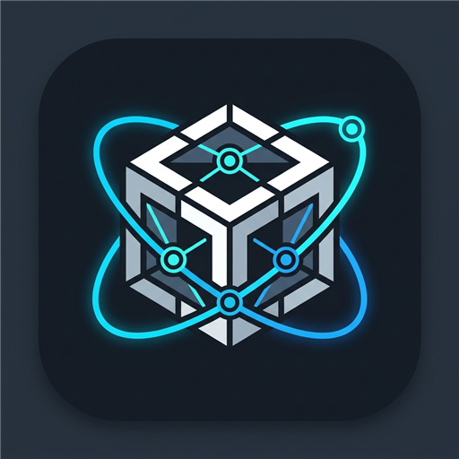
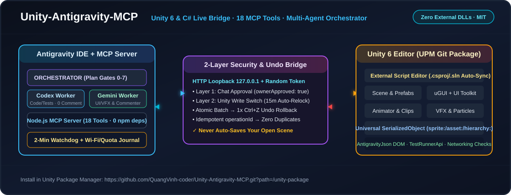
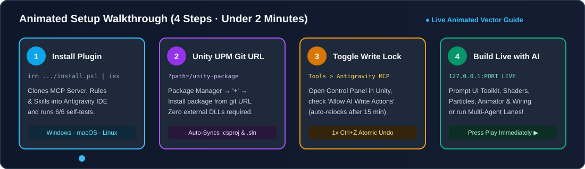

#  Unity-Antigravity-MCP

Cầu nối [Model Context Protocol (MCP)](https://modelcontextprotocol.io/) không dùng dependency ngoài cho Unity 6 (`6000.0+`) và Antigravity IDE: tự tái sinh `.csproj`/`.sln` xử lý lỗi `CS0229`, cung cấp 18 công cụ MCP (9 chỉ đọc, 9 ghi nguyên tử 1 lần `Ctrl + Z`) có khóa 2 lớp, kèm tùy chọn Multi-Agent Orchestrator.

[](https://github.com/QuangVinh-coder/Unity-Antigravity-MCP/actions/workflows/ci.yml) [](plugin.json) [](unity-package/package.json) [](LICENSE)

Trạng thái: đang duy trì (`v1.0.0`, kiểm thử trên Windows 11 · Unity `6000.0.74f1` · Node `22`/`24`, CI Ubuntu Node `22`). Giấy phép: [MIT](LICENSE).



## Vì sao chọn Unity-Antigravity-MCP

- Không dependency ngoài ở cả 2 phía: MCP Server chạy thuần Node `18+` (không `npm install`), gói UPM dùng [`AntigravityJson`](unity-package/Editor/Bridge/AntigravityJson.cs) thuần C# nên không cần `Newtonsoft.Json` hay DLL ngoài.
- Sửa lỗi đỏ `CS0229` tận gốc: [`AntigravityExternalCodeEditor`](unity-package/Editor/CodeEditor/AntigravityExternalCodeEditor.cs) (`IExternalCodeEditor`) tái sinh `.sln`/`.csproj` theo `.asmdef`, kèm `unity_inspect_csharp_project` chạy được cả khi Unity đóng.
- Khóa 2 lớp và Undo nguyên tử: 9 tool Tầng 2 bị chặn Fail-Closed khi thiếu `ownerApproved: true`, `approvalSummary` (>= 5 ký tự) hoặc `operationId`; Unity tắt mặc định `Allow AI Write Actions` (tự khóa sau 15 phút). Mỗi batch gộp thành 1 lần `Ctrl + Z`, tự rollback qua `Undo.RevertAllDownToGroup` khi lỗi, và không tự lưu Scene.
- Chống tạo trùng khi rớt Wi-Fi, Domain Reload hoặc hết usage: [`Operation Journal`](server/offline-tools.mjs) (`APPLIED`, `ROLLED_BACK`, `UNDONE_BY_USER`) phát lại idempotent (`idempotentReplay: true`), kết hợp [`watchdog_runner.mjs`](server/watchdog_runner.mjs) giám sát tiến trình nền mỗi `120s` (dọn `VBCSCompiler.dll` treo handle).

Dự án không thay thế CI/CD build/deploy Unity, không tự commit Git hay Plastic SCM, và chặn ghi khi đang Play Mode (`409 BLOCKED_IN_PLAY_MODE`). Nếu chỉ cần mở script từ Unity, gói `com.unity.ide.visualstudio` mặc định là đủ.

## Cài đặt nhanh và kiểm thử đầu tiên

Yêu cầu: Unity `6000.0+` (kèm `com.unity.ide.visualstudio` >= `2.0.0`), Node.js `18+`, Git, Antigravity IDE.

### 1. Cài MCP plugin vào Antigravity IDE (1 lần cho cả máy)

Windows (PowerShell):
```powershell
irm https://raw.githubusercontent.com/QuangVinh-coder/Unity-Antigravity-MCP/main/install.ps1 | iex
```

macOS hoặc Linux (Bash):
```bash
curl -fsSL https://raw.githubusercontent.com/QuangVinh-coder/Unity-Antigravity-MCP/main/install.sh | bash
```

Script tự clone kho vào `~/.gemini/config/plugins/unity-antigravity-mcp/`, sinh tệp `mcp_config.json` theo đường dẫn thực của máy rồi chạy bộ kiểm thử tự động. Khi chạy trực tiếp từ bản clone, bạn có thể truyền thêm `-InstallDir`, `-RepoUrl`, `-InitMultiAgent` trên Windows hoặc `--install-dir`, `--init-multi-agent` trên macOS/Linux.

### 2. Xác minh MCP Server hoạt động (chạy được khi chưa mở Unity)

```bash
node --test server/test-mcp-server.mjs
```

Kết quả mong đợi từ [`server/test-mcp-server.mjs`](server/test-mcp-server.mjs):
```text
✔ 1. Handshake MCP initialize & tools/list trả đúng 18 tools (9 Tier-1 + 9 Tier-2)
✔ 2. Fail-Closed Tier 2 Gate: chặn tuyệt đối mọi lệnh ghi thiếu ownerApproved=true, approvalSummary hoặc operationId
...
ℹ tests 6
ℹ pass 6
ℹ fail 0
```

### 3. Cài cầu nối vào dự án Unity 6 qua Package Manager

Mở dự án Unity 6, vào menu `Window > Package Manager`, bấm nút `+` rồi chọn `Install package from git URL...` và dán địa chỉ sau:

```text
https://github.com/QuangVinh-coder/Unity-Antigravity-MCP.git?path=/unity-package
```

Bạn cũng có thể thêm trực tiếp khóa `"com.vinh.antigravity-unity-bridge"` trỏ về đúng URL trên trong `Packages/manifest.json`.

Tiếp theo, vào `Edit > Preferences > External Tools` (trên macOS là `Unity > Settings > External Tools`), chọn `Antigravity IDE` làm External Script Editor rồi bấm `Regenerate project files`.

### 4. Thử gọi công cụ đầu tiên trong Antigravity IDE

Khi dự án Unity đang mở, gõ câu sau vào khung chat Antigravity IDE:

> "Kiểm tra trạng thái Unity Editor và đối chiếu các file `.asmdef` với `.csproj` hiện tại."

AI sẽ gọi 2 công cụ Tầng 1 chỉ đọc là `unity_get_editor_status` và `unity_inspect_csharp_project`, sau đó trả JSON xác nhận kết nối cùng chẩn đoán `CS0229`:
```json
{
  "connected": true,
  "writeEnabled": false,
  "csharpDiagnosis": { "missingCsprojCount": 0, "hasCs0229Risk": false }
}
```



## Bảng điều khiển Unity Editor và demo

Vào `Tools > Antigravity MCP > Control Panel` trong Unity Editor để theo dõi trạng thái cầu nối và kiểm soát quyền ghi:


- Thanh trạng thái trên cùng hiển thị `127.0.0.1:<PORT>` và `Project Hash` (16 ký tự SHA-256 rút gọn từ đường dẫn dự án) khi Unity Bridge đang lắng nghe.
- Công tắc `Allow AI Write Actions` mặc định tắt (`READ_ONLY`). Bạn chỉ bật khi muốn chạy các batch đã duyệt trong chat, và công tắc sẽ tự tắt sau 15 phút (`900s`) không có thao tác ghi.
- Hộp chọn `Require Unity Popup Confirmation Per Batch` bật thêm hộp thoại `Cho phép / Từ chối` ngay trong Unity trước từng batch.
- Hai nút thao tác nhanh gồm `Sync .csproj & .sln Now` (tái sinh file dự án C# sau khi thêm `.asmdef`) và `Restart Bridge Server` (khởi động lại HTTP loopback cục bộ). Bảng Audit Log bên dưới lưu 100 thao tác ghi gần nhất trong phiên.

### Hướng dẫn xem và quay video demo

GitHub hỗ trợ kéo thả trực tiếp file `.mp4` hoặc `.mov` vào mô tả bản phát hành hoặc trình sửa README trên web để phát ngay trong trình duyệt. Các bản ghi hình demo theo từng phiên bản được đính kèm trên trang GitHub Releases theo 3 kịch bản kiểm chứng thực tế:

1. Cài đặt và chẩn đoán `CS0229`: chạy `install.ps1` hoặc `install.sh`, cài gói UPM, mở `Tools > Antigravity MCP > Control Panel` và chạy `unity_inspect_csharp_project`.
2. Dựng UI và hoàn tác trong 1 bước: bật `Allow AI Write Actions`, chạy `unity_batch_ui` (uGUI hoặc UI Toolkit `.uxml`/`.uss`) cùng `unity_universal_serialized_batch` gán `ObjectReference` (`hierarchy:`, `asset:`, `sprite:`, `guid:`), rồi bấm `Ctrl + Z` trong Unity để hoàn tác cả batch.
3. Điều phối Multi-Agent: chạy song song nhánh ảo `agents/branches/` giữa Gemini và Codex, sau đó chạy `comment-guard.mjs verify` để xác nhận phần code giữ nguyên sau bước thêm comment.

## Tổng quan 18 công cụ MCP

Toàn bộ 18 công cụ chia thành 2 tầng cố định. Xem bảng tham chiếu chi tiết từng công cụ, danh sách `action` và ví dụ JSON payload tại [docs/MCP_TOOLS_REFERENCE.md](docs/MCP_TOOLS_REFERENCE.md).

| Tầng | Số lượng | Cơ chế an toàn | Danh sách công cụ |
|---|---|---|---|
| Tầng 1 (Chỉ đọc và chẩn đoán) | 9 công cụ | Gọi tự do; 4 công cụ chạy được khi Unity đóng | `unity_get_editor_status`, `unity_get_console_logs`, `unity_get_hierarchy` (cảnh báo trùng root `PRE-3`, Missing Script, `NetworkBehaviour` thiếu `NetworkObject`), `unity_inspect_object_deep`, `unity_find_assets_and_types`, `unity_list_packages`, `unity_inspect_csharp_project`, `unity_get_operation_journal`, `unity_run_tests`. |
| Tầng 2 (Ghi theo batch nguyên tử) | 9 công cụ | Duyệt 2 lớp, 1 nhóm `Ctrl + Z`, tự rollback khi lỗi, không tự lưu Scene | `unity_batch_scene_and_prefab`, `unity_batch_ui` (uGUI và UI Toolkit), `unity_batch_animation`, `unity_batch_vfx_and_particle`, `unity_batch_assets_and_so`, `unity_batch_package_and_project`, `unity_universal_serialized_batch`, `unity_rollback_batch`, `unity_save_open_scene`. |

## Tùy chọn: Multi-Agent Orchestrator (Antigravity + Codex)

Nếu máy bạn có cả Antigravity IDE (Gemini) và Codex CLI (`codex`), bạn có thể cài thêm bộ khung điều phối đa-agent từ `templates/multi-agent/` vào dự án Unity bằng cờ `-InitMultiAgent` hoặc `--init-multi-agent`:

```powershell
# Windows
.\install.ps1 -InitMultiAgent "D:\Path\To\YourUnityProject"
```
```bash
# macOS / Linux
./install.sh --init-multi-agent /path/to/your/unity-project
```


| Tác vụ | Lệnh chạy tại thư mục gốc dự án Unity |
|---|---|
| Khởi tạo, kiểm tra hoặc gom nhánh ảo | `node .agents/skills/agent-orchestrate/scripts/manage_virtual_branch.mjs <init\|status\|integrate\|clean> <path>` |
| Bảo vệ code khi Gemini comment sau Codex | `node Tools/AIControlPlane/comment-guard.mjs <snapshot\|verify> <label> [files...]` |
| Phục hồi sau hết usage (`exit 3`) hoặc rớt mạng (`exit 4`) | `node .agents/skills/agent-orchestrate/scripts/manage_virtual_branch.mjs recover --all` |
| Chạy Unity Batchmode hoặc Test qua Watchdog 2 phút | `node .agents/skills/agent-orchestrate/scripts/watchdog_runner.mjs run --label <name> --log-file <log> -- <cmd>` |

Sơ đồ luồng đầy đủ, quy ước nhánh `DISJOINT` và `CONFLICT_CLUSTER`, worker song song `-w1`/`-w2` cùng hướng dẫn cấu hình `.gitignore`/`ignore.conf` nằm tại [docs/MULTI_AGENT_GUIDE.md](docs/MULTI_AGENT_GUIDE.md).

## Phục hồi sự cố và kiểm thử tự động

| Tình huống sự cố | Cách xử lý trong mã nguồn |
|---|---|
| Rớt Wi-Fi lúc đang gửi batch MCP | Unity Bridge đối chiếu `operationId` trong `Operation Journal`; nếu đã `APPLIED` và đối tượng còn trên Scene, bridge trả `idempotentReplay: true` và không tạo lại đối tượng. |
| Unity Domain Reload làm ngắt socket | [`server/bridge-client.mjs`](server/bridge-client.mjs) thử lại tối đa 6 lần (cách nhau `350ms`) cho lệnh sync và assets, rồi đối chiếu Journal để xác nhận kết quả (`recoveredFromJournalAfterReload: true`). |
| Hết usage hoặc quay lại sau nhiều giờ | Công tắc `Allow AI Write Actions` tự khóa về `READ_ONLY` sau 15 phút (`900s`) không hoạt động (`403 WRITE_LOCKED_IN_UNITY`). Phiên mới đọc `unity_get_operation_journal` trước khi gửi tiếp. |
| Unity Batchmode treo vì `VBCSCompiler.dll` | [`server/watchdog_runner.mjs`](server/watchdog_runner.mjs) kiểm tra mỗi `120s`, tự dọn cây tiến trình con nếu log đã ghi dấu hoàn tất (`COMPLETED_HUNG_CLEANED`) hoặc dừng và chạy lại nếu treo giữa chừng (`STALLED_MID_TASK`). |

Chạy bộ kiểm tra cục bộ giống pipeline [`.github/workflows/ci.yml`](.github/workflows/ci.yml):
```bash
node --test server/test-mcp-server.mjs
node templates/multi-agent/Tools/AIControlPlane/scan-secrets.mjs server unity-package rules skills templates
```

## Trạng thái, giới hạn và giấy phép

Dự án đang ở phiên bản `v1.0.0` và được duy trì tích cực. Bộ kiểm thử tự động (`6/6 pass`) cùng bộ quét bí mật (`0` phát hiện) chạy trên GitHub Actions với Ubuntu và Node.js `22`. Cầu nối trực tiếp với Unity Editor đã được kiểm thử thực tế trên Windows 11 với Unity `6000.0.74f1` và Node.js `22`/`24`.

Các giới hạn hiện có:

- Unity Editor phải đang mở và không ở Play Mode khi chạy 9 công cụ Tầng 2.
- Chức năng `Sync .csproj & .sln` yêu cầu dự án Unity có sẵn gói `com.unity.ide.visualstudio` từ bản `2.0.0` trở lên.
- `AntigravityExternalCodeEditor` mới tự quét đường dẫn mặc định `%LOCALAPPDATA%\Programs\Antigravity\Antigravity.exe` trên Windows. Trên macOS và Linux, bạn cần chọn tay file thực thi Antigravity IDE trong `Preferences > External Tools`, và cầu nối Live Bridge trên hai hệ điều hành này chưa có CI runner Unity kiểm thử tự động.

Phát hành theo giấy phép MIT, xem toàn văn tại [LICENSE](LICENSE).
