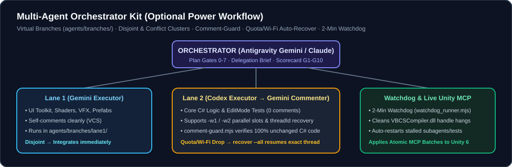
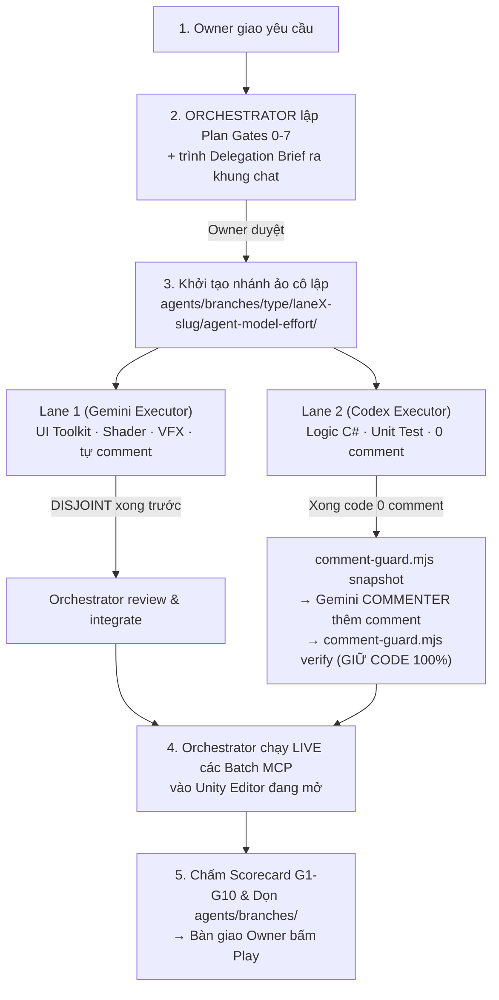

# Hướng dẫn bộ Multi-Agent Orchestrator (`templates/multi-agent/`)

Bộ khung tùy chọn này dành cho máy có cả Antigravity IDE (Gemini) và Codex CLI (`codex`). Bạn cài độc lập vào từng dự án Unity (dùng Git hoặc Plastic SCM) mà không ảnh hưởng tới gói Unity Bridge. Quay lại trang tổng quan tại [README.md](../README.md).

## 1. Cài đặt vào dự án Unity mục tiêu

Sau khi đã cài plugin ở bước 1 (vào `~/.gemini/config/plugins/unity-antigravity-mcp/`), chạy lệnh installer từ bất kỳ thư mục nào kèm đường dẫn tới dự án Unity:

Windows (PowerShell):
```powershell
& "$HOME\.gemini\config\plugins\unity-antigravity-mcp\install.ps1" -InitMultiAgent "D:\Path\To\YourUnityProject"
```

macOS hoặc Linux (Bash):
```bash
"$HOME/.gemini/config/plugins/unity-antigravity-mcp/install.sh" --init-multi-agent /path/to/your/unity-project
```

Script sao chép 3 thành phần vào thư mục gốc của dự án mục tiêu:

- `.agents/`: quy tắc (`control-plane-governance.md`, `team-workflow.md`) cùng các skill điều phối (`agent-orchestrate`, `agent-plan`, `agent-plan-executor`, `agent-handoff`, `agent-research`, `agent-review-scorecard`, `agent-scorecard-repair`, `vietnamese-code-comments`).
- `Tools/AIControlPlane/`: các script kiểm soát chất lượng gồm `comment-guard.mjs`, `scan-csharp-rules.mjs` và `scan-secrets.mjs`.
- `AGENTS.md` (nếu dự án đã có sẵn file này, script lưu bản mẫu thành `AGENTS.multi-agent.template.md` để tránh ghi đè).

Với dự án dùng Git hoặc Plastic SCM, hãy thêm dòng `/agents/branches` vào `.gitignore` hoặc `ignore.conf` để thư mục nhánh ảo tạm không lọt vào lịch sử commit/check-in. Thư mục `agents/branches/` nằm ngoài `Assets/` nên Unity không biên dịch trùng class (`CS0101`).

## 2. Sơ đồ kiến trúc và luồng vận hành





### Quy ước nhánh `DISJOINT` và `CONFLICT_CLUSTER`

Đường dẫn nhánh ảo bắt buộc đủ 5 cấp theo dạng `agents/branches/<type>/lane<X>-<task-slug>/<agent>-<model>-<effort>[-w<N>]`, trong đó `<type>` thuộc 1 trong 5 giá trị `feature`, `fix`, `refactor`, `test`, `docs`. Khi nhiều worker dùng cùng model trên một lane, thêm hậu tố `-w1`, `-w2`, ... để tách thư mục.

- Nếu `lane<X>-<task-slug>` chỉ có 1 thư mục worker (`DISJOINT`), nhánh đó hoàn tất trước sẽ được review và `integrate` ngay.
- Nếu `lane<X>-<task-slug>` có từ 2 thư mục worker trở lên (`CONFLICT_CLUSTER`), lệnh `manage_virtual_branch.mjs integrate` sẽ chặn tích hợp cho đến khi mọi worker trong cùng cụm đều có `BRANCH_HANDOFF.md` và ở trạng thái `COMPLETED` hoặc `INTEGRATED`.

## 3. Các lệnh điều phối cốt lõi

### 3.1 Quản lý nhánh ảo (`manage_virtual_branch.mjs`)

```powershell
# Khởi tạo nhánh ảo và clone các file gốc sẽ chỉnh sửa (tự lưu SHA-256 baseline)
node .agents/skills/agent-orchestrate/scripts/manage_virtual_branch.mjs init agents/branches/feature/lane1-shop-ui/gemini-4-neon-high Assets/Scripts/ShopUI.cs

# Xem trạng thái 1 lane hoặc toàn bộ các lane
node .agents/skills/agent-orchestrate/scripts/manage_virtual_branch.mjs status agents/branches/feature/lane1-shop-ui
node .agents/skills/agent-orchestrate/scripts/manage_virtual_branch.mjs status --all

# Ghi checkpoint thủ công (status: INITIALIZED|RUNNING|PAUSED_QUOTA|PAUSED_NETWORK|BLOCKED|COMPLETED|INTEGRATED)
node .agents/skills/agent-orchestrate/scripts/manage_virtual_branch.mjs checkpoint agents/branches/feature/lane1-shop-ui/gemini-4-neon-high --status COMPLETED --step "done-ui"

# Tích hợp file từ nhánh ảo vào cây thư mục chính (tự chặn vùng cấm như Library/, .csproj, .sln)
node .agents/skills/agent-orchestrate/scripts/manage_virtual_branch.mjs integrate agents/branches/feature/lane1-shop-ui/gemini-4-neon-high

# Dọn sạch nhánh ảo sau khi chấm Scorecard xong
node .agents/skills/agent-orchestrate/scripts/manage_virtual_branch.mjs clean agents/branches/feature/lane1-shop-ui
```

### 3.2 Gọi và nối tiếp thread Codex có phục hồi tự động

Mở thread mới có ghi Write-Ahead State vào `BRANCH_MANIFEST.json` bằng cờ `--branch`:
```powershell
node .agents/skills/agent-orchestrate/scripts/new_codex_thread.mjs lane2-logic gpt-6.2-sol high prompt.md out.md --branch agents/branches/feature/lane2-logic/codex-gpt-6.2-sol-high
```

Mã thoát của `new_codex_thread.mjs` và `resume_codex_thread.mjs`:
- `0`: `COMPLETED` (hoặc `BLOCKED: plan` sạch).
- `2`: sai tham số hoặc model/effort không nằm trong bảng cho phép.
- `3`: `PAUSED_QUOTA` (hết usage hoặc HTTP 429, đã lưu `threadId` vào `BRANCH_MANIFEST.json`).
- `4`: `PAUSED_NETWORK` (rớt Wi-Fi hoặc timeout, đã lưu `threadId` vào `BRANCH_MANIFEST.json`).

Để tạo kế hoạch phục hồi cho các nhánh đang dở (bỏ qua nhánh đã `COMPLETED`/`INTEGRATED` và in sẵn lệnh `resume_codex_thread.mjs` theo từng `threadId`), chạy:
```powershell
node .agents/skills/agent-orchestrate/scripts/manage_virtual_branch.mjs recover --all
```

### 3.3 Phân vai comment an toàn (`comment-guard.mjs`)

Khi Codex viết code và unit test (0 comment code mới), sau khi tích hợp file sang cây chính hãy chụp bản gốc, giao Gemini thêm comment tiếng Việt, rồi chạy kiểm chứng:
```powershell
node Tools/AIControlPlane/comment-guard.mjs snapshot my-label Assets/Scripts/MyLogic.cs
# (Giao Gemini COMMENTER thêm comment tiếng Việt)
node Tools/AIControlPlane/comment-guard.mjs verify my-label
```
Lệnh `verify` bỏ toàn bộ comment và chuỗi `Tooltip("...")` ở cả bản chụp lẫn file hiện tại rồi so từng dòng code. Exit code `0` xác nhận `code giữ nguyên ở N/N file`.

### 3.4 Giám sát tiến trình nền chu kỳ 2 phút (`watchdog_runner.mjs`)

Dùng script này khi chạy Unity Batchmode, test runner hoặc subagent dễ bị treo do tiến trình con (`dotnet.exe` hoặc `VBCSCompiler.dll`) giữ handle stdout/log:
```powershell
node .agents/skills/agent-orchestrate/scripts/watchdog_runner.mjs run --label unity-tests --log-file "$env:TEMP\UnityTests.log" -- "Unity.exe" -batchmode -nographics -projectPath "." -runTests -quit -logFile "$env:TEMP\UnityTests.log"
```

Các tùy chọn gồm `--interval-ms <ms>` (mặc định `120000`), `--max-retries <n>` (mặc định `1`), `--log-file <path>`, `--done-regex <regex>` và `--branch <branchPath>`.

Watchdog tự xử lý 2 kịch bản treo:
- `COMPLETED_HUNG_CLEANED`: file log đã xuất hiện dấu kết thúc (như `Exiting batchmode successfully now!` hoặc `</test-run>`) nhưng tiến trình con còn giữ handle; watchdog tắt cây tiến trình dư thừa và trả mã thoát thật.
- `STALLED_MID_TASK`: không có thêm byte stdout/stderr hay tăng kích thước file log trong trọn chu kỳ `intervalMs`; watchdog dừng cây tiến trình treo (mã `124`) và tự khởi động lại theo `--max-retries`.
